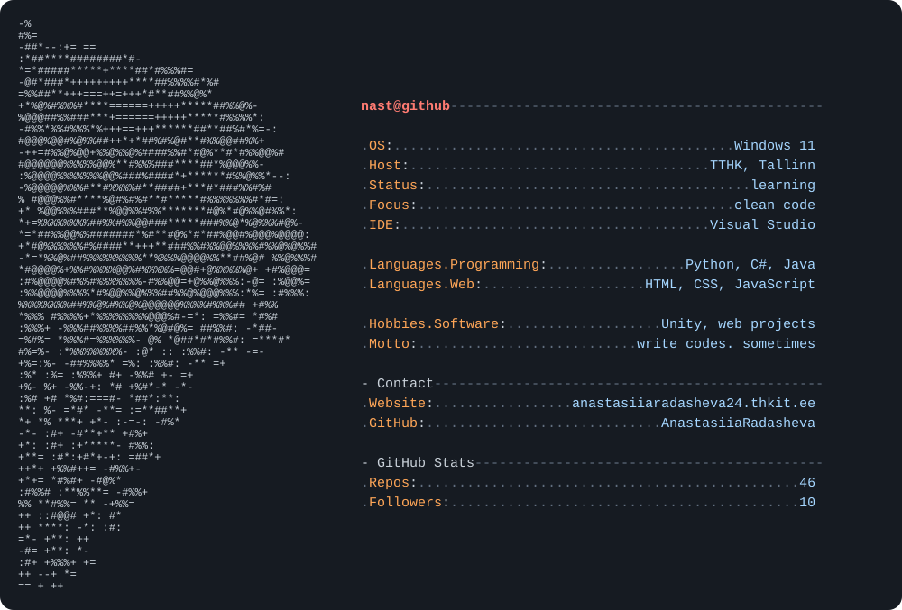

<p align="center">
  
</p>

<p align="center">
  
  
  
</p>


```json
{
  "languages": ["Python", "C#", "Java"],
  "web":       ["HTML5", "CSS3", "JavaScript", "PHP"],
  "gamedev":   ["Unity"],
  "databases": ["MySQL", "MariaDB"],
  "tools":     ["XAMPP", "Git", "VS Code"]
}
```

<p align="center">
  
</p>

---


<p align="center">
  <a href="https://www.instagram.com/eqwi_ww2"></a>
  <a href="https://anastasiiaradasheva24.thkit.ee/wp/"></a>
</p>

<p align="center">
  
</p>

<p align="center">
  
</p>
