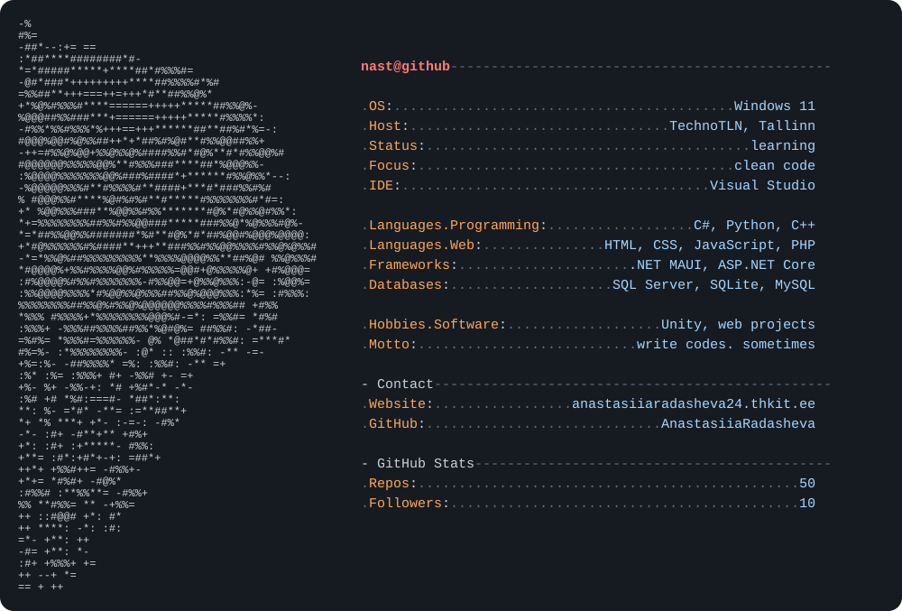

<p align="center">
  
</p>

<p align="center">
  
  
  
</p>


```json
{
  "languages": ["C#", "Python", "Java", "C++ (Arduino)"],
  "dotnet":    [".NET MAUI", "ASP.NET Core MVC", "Entity Framework Core", "WinForms"],
  "web":       ["HTML5", "CSS3", "JavaScript", "PHP", "Node.js"],
  "gamedev":   ["Unity"],
  "databases": ["SQL Server", "SQLite", "MySQL", "MariaDB"],
  "testing":   ["xUnit", "Selenium"],
  "tools":     ["Git", "Visual Studio", "VS Code", "XAMPP", "Tinkercad"]
}
```

<p align="center">
  
</p>

---


| Project | Stack | About |
|---|---|---|
| 🏫 [KeelteKool2](https://github.com/AnastasiiaRadasheva/KeelteKool2) | ASP.NET Core MVC · EF Core · Identity · xUnit | Language school management web app (team project) |
| 🧩 [LangGuess](https://github.com/AnastasiiaRadasheva/LangGuess) | .NET MAUI · SQLite | Wordle for programming languages |
| 🏰 [CityExplorer](https://github.com/AnastasiiaRadasheva/CityExplorer) | .NET MAUI · SQLite · MVVM | Tallinn city guide app |
| 📱 [MauiPractice](https://github.com/AnastasiiaRadasheva/MauiPractice) | .NET MAUI | All my mobile practice tasks in one app |
| 🤖 [Arduino-Robotics](https://github.com/AnastasiiaRadasheva/Arduino-Robotics) | Arduino · C++ | 8 hardware projects with demo videos |
| 📐 [FunctionAnalyzer](https://github.com/AnastasiiaRadasheva/FunctionAnalyzer) | ASP.NET Core MVC | Derivatives, extrema and graphs |
| 🐍 [Snake](https://github.com/AnastasiiaRadasheva/Snake) | C# · .NET 8 | Console Snake game |
| 🔌 [games-api](https://github.com/AnastasiiaRadasheva/games-api) | Node.js · Express | REST API for games |

---


<p align="center">
  <a href="https://www.instagram.com/eqwi_ww2"></a>
  <a href="https://anastasiiaradasheva24.thkit.ee/wp/"></a>
</p>

<p align="center">
  
</p>

<p align="center">
  
</p>
